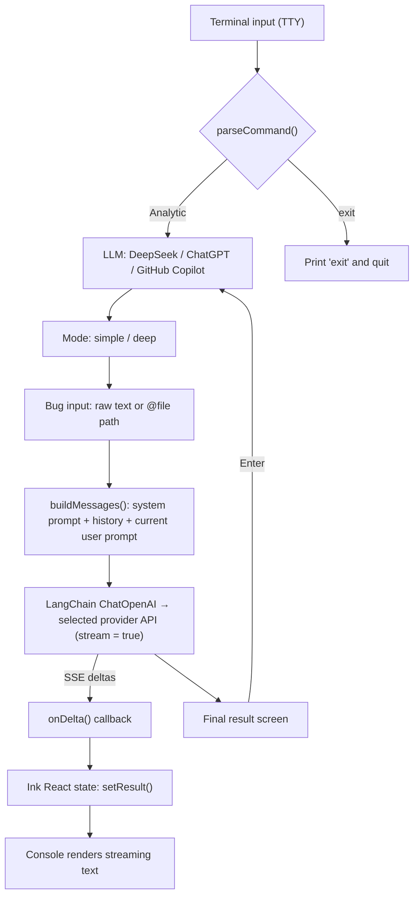
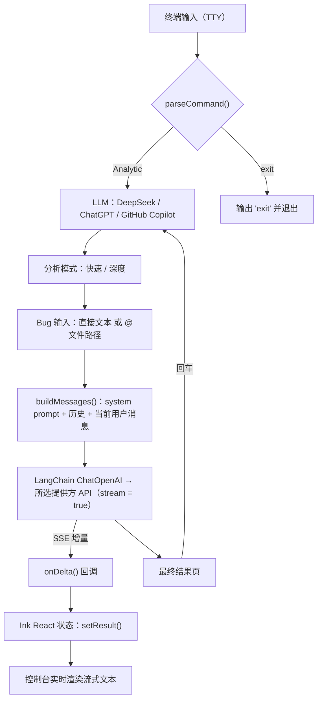

# BugAnalytic-Agent

An interactive **LangChain multi-LLM** Bug analysis agent, built with **Node.js + React (Ink) + TypeScript**.

## English

### What it is

BugAnalytic-Agent turns a raw bug report into a structured analysis through LangChain's `ChatOpenAI` integration. Before each analysis, select DeepSeek, ChatGPT, or GitHub Copilot (via GitHub Models); responses are streamed back to your terminal through their OpenAI-compatible Chat Completions APIs.

- Type `Analytic` to open the analysis menu
- First choose an LLM: `1. DeepSeek` / `2. ChatGPT` / `3. GitHub Copilot` / `4. exit`
- Then choose the analysis mode: `1. simple-analytic` (quick analysis) / `2. deep-analytic` (in-depth analysis) / `3. back` / `4. exit`
- Type `exit` to print `exit` and quit
- After an analysis, enter additional evidence or a follow-up question to continue the same Bug conversation; enter `menu` to start a new analysis
- For a new analysis, optionally provide `.dlt`/`.txt` logs, multiple analysis keywords, and one or more local source repositories

### Quick start

#### 1. Install dependencies

```bash
npm install
```

#### 2. Configure a local API key

Copy `.env.example` to `.env` and configure the key for every provider you want to use. `.env` is ignored by Git, or you can set the same values through system environment variables:

```bash
# Linux / macOS
cp .env.example .env
```

Supported environment variables:

| Variable | Required | Description | Default |
| --- | --- | --- | --- |
| `DEEPSEEK_API_KEY` | For DeepSeek | DeepSeek API key | - |
| `DEEPSEEK_BASE_URL` | No | API base URL | `https://api.deepseek.com` |
| `DEEPSEEK_MODEL` | No | Model name | `deepseek-chat` |
| `OPENAI_API_KEY` | For ChatGPT | OpenAI API key | - |
| `OPENAI_BASE_URL` | No | API base URL | `https://api.openai.com/v1` |
| `OPENAI_MODEL` | No | Model name | `gpt-4o-mini` |
| `COPILOT_API_KEY` | For GitHub Copilot | GitHub Models access token; `GITHUB_TOKEN` is accepted as a fallback | - |
| `COPILOT_BASE_URL` | No | GitHub Models API base URL | `https://models.github.ai/inference` |
| `COPILOT_MODEL` | No | GitHub Models model ID | `openai/gpt-4.1` |

GitHub Copilot mode uses the GitHub Models API, so the token must be authorized to access GitHub Models. `COPILOT_BASE_URL` and `COPILOT_MODEL` can be overridden for a compatible endpoint or an available model.

#### 3. Run

```bash
# Development (run directly with tsx)
npm run dev

# Or build and run
npm run build
npm start
```

#### Usage

1. Start the CLI and type `Analytic` + Enter to open the menu
2. Select DeepSeek, ChatGPT, or GitHub Copilot
3. Enter `1` for simple-analytic (quick) or `2` for deep-analytic (in-depth)
4. Paste a bug description, or use `@examples/bug-login.txt` to read a sample file
5. Watch the selected LLM stream the analysis back into the console
6. Enter more evidence or a follow-up question to continue analyzing the same Bug with the previous conversation retained
7. Enter `menu` to clear the current Bug context and choose a new provider and mode; enter `4` or `exit` to quit

#### Evidence inputs

After the Bug description, the CLI guides you through three optional inputs:

1. **Logs** — Enter one or more `.dlt` or `.txt` paths, or a directory containing them. Separate multiple paths with commas or semicolons. Directories are scanned recursively; `skip` omits logs.
2. **Keywords** — Enter one or more comma- or semicolon-separated terms. They select matching log lines (with surrounding context) and source snippets. When omitted, the log extractor focuses on common error signals.
3. **Repositories** — Enter one or more local repository directories, separated by commas or semicolons. The agent scans supported source files and supplies keyword-matched excerpts, not entire repositories. Enter `skip` to omit source context.

Each log and source file is capped at 512 KiB, up to 50 log files and 20 source files, so prompts remain bounded. Binary DLT records with a standard `DLT\x01` storage header are decoded into timestamped, printable message excerpts; text-exported DLT files are handled as plain text.

> When stdin is not a TTY (for example, a pipe), the CLI automatically switches to line mode, which is convenient for CI and scripting:
>
> ```bash
> printf "Analytic\n4\n" | node dist/cli.js
> ```

### Architecture

The data flow is: **user input → LLM selection → analysis mode selection → conversation memory → prompt building → LangChain model call → streamed result back to the console**. The latest eight complete user/assistant exchanges for the active Bug are kept in memory. Selecting a new provider/mode or entering `menu` clears that memory so unrelated Bugs do not share context.



The same flow in plain text (`input -> provider -> mode -> LangChain -> API call -> console`):

```
1. INPUT
   terminal (TTY)  ->  "Analytic"  ->  parseCommand("idle")  ->  main menu
   provider menu   ->  "1" / "2" / "3" -> parseCommand("provider") -> LLM provider
   analysis menu   ->  "1" / "2"   ->  parseCommand("analysis")  ->  simple | deep
   bug description / follow-up -> raw text or "@examples/bug-login.txt" -> resolveBugInput()

2. PROMPT
   buildMessages(kind, bugText, history) -> [ system prompt, prior user/assistant turns, current user prompt ]

3. LANGCHAIN MODEL CALL
   analyzeBug() -> chatCompletion() -> ChatOpenAI.stream()
   POST {selected provider base URL}/chat/completions
   body: { model: selected provider model, messages, stream: true, temperature: 0.7 }
   response: text/event-stream (SSE, parsed by LangChain)
        |
        +-- "data: {...}" -> delta.content -> onDelta(delta)   (each chunk)
        +-- "data: [DONE]"                  -> full text       (end of stream)

4. CONSOLE OUTPUT
   onDelta() -> setResult(full) -> Ink re-renders -> streaming text appears live
   stream ends -> "result" screen -> Enter -> back to main menu
```

Key pieces:

- `cli.tsx` — entry point: renders the Ink app for a TTY, otherwise runs line mode
- `app.tsx` — Ink React state machine (`idle → provider → analysis → input → analyzing → result`)
- `llm/prompts.ts` — builds the system/user messages for both analysis modes
- `llm/langchain.ts` — LangChain `ChatOpenAI` client for each provider's OpenAI-compatible API and streaming tokens
- `llm/analyze.ts` — orchestrates config + prompt + LangChain model call
- `llm/conversation.ts` — retains the last eight complete exchanges for the active Bug conversation
- `onDelta` — pushes each streamed chunk into React state so the console updates live

### Tests

```bash
npm test
```

### Project layout

```
src/
├── cli.tsx               # CLI entry (renders React UI for TTY, otherwise line mode)
├── app.tsx               # Ink React main UI and state machine
├── config.ts             # Reads DeepSeek, OpenAI, and Copilot local environment variables
├── command.ts            # Command parsing (provider / analysis mode / exit)
├── bug-input.ts          # Bug input (raw text or @file path)
├── line-mode.ts          # Non-interactive line-mode runner
├── texts.ts              # Banner / menu text
├── components/           # Banner, Menu, Spinner, TextInput components
├── llm/
│   ├── langchain.ts      # LangChain ChatOpenAI client (selected provider streaming)
│   ├── prompts.ts        # Simple / deep analysis prompts
│   └── analyze.ts        # Analysis orchestration
└── *.test.ts             # Unit tests
```

### Tech stack

- Node.js 18+ (built-in `fetch`)
- React 18 + Ink 5 (React renderer for terminals)
- TypeScript 5
- LangChain (`@langchain/core` + `@langchain/openai`)
- DeepSeek, OpenAI, and GitHub Models APIs (streaming through OpenAI-compatible endpoints)

## 中文说明

基于 **LangChain 多模型** 的 Bug 分析 Agent。使用 **Node.js + React (Ink) + TypeScript** 实现的交互式 CLI：

- 输入 `Analytic` 进入分析菜单
- 先选择 LLM：`1. DeepSeek` / `2. ChatGPT` / `3. GitHub Copilot` / `4. exit`
- 再选择分析模式：`1. simple-analytic`（快速分析）/ `2. deep-analytic`（深度分析）/ `3. back` / `4. exit`
- 输入 `exit` 输出 `exit` 并退出
- 单次分析完成后可继续输入补充信息或追问；系统会保留当前 Bug 的上下文。输入 `menu` 可清空上下文并开始新的分析
- 新分析时可选填 `.dlt`/`.txt` 日志、多个分析关键词，以及一个或多个本地工程仓库

### 快速开始

#### 1. 安装依赖

```bash
npm install
```

#### 2. 配置本地 API Key

复制 `.env.example` 为本地 `.env`，为要使用的提供方填写对应 Key。`.env` 已被 Git 忽略，也可以用同名系统环境变量替代：

```bash
# Linux / macOS
cp .env.example .env
```

支持的环境变量：

| 变量 | 必填 | 说明 | 默认值 |
| --- | --- | --- | --- |
| `DEEPSEEK_API_KEY` | 使用 DeepSeek 时必填 | DeepSeek API Key | - |
| `DEEPSEEK_BASE_URL` | 否 | API 地址 | `https://api.deepseek.com` |
| `DEEPSEEK_MODEL` | 否 | 模型名称 | `deepseek-chat` |
| `OPENAI_API_KEY` | 使用 ChatGPT 时必填 | OpenAI API Key | - |
| `OPENAI_BASE_URL` | 否 | API 地址 | `https://api.openai.com/v1` |
| `OPENAI_MODEL` | 否 | 模型名称 | `gpt-4o-mini` |
| `COPILOT_API_KEY` | 使用 GitHub Copilot 时必填 | GitHub Models 访问令牌；也可使用 `GITHUB_TOKEN` | - |
| `COPILOT_BASE_URL` | 否 | GitHub Models API 地址 | `https://models.github.ai/inference` |
| `COPILOT_MODEL` | 否 | GitHub Models 模型 ID | `openai/gpt-4.1` |

GitHub Copilot 模式通过 GitHub Models API 调用，令牌必须具有 GitHub Models 访问权限。`COPILOT_BASE_URL` 和 `COPILOT_MODEL` 可按兼容服务或可用模型覆盖。

#### 3. 运行

```bash
# 开发模式（tsx 直接运行）
npm run dev

# 或先构建再运行
npm run build
npm start
```

#### 使用示例

1. 启动后输入 `Analytic` 回车，进入图形菜单
2. 选择 DeepSeek、ChatGPT 或 GitHub Copilot
3. 输入 `1` 选择 simple-analytic（快速分析），或 `2` 选择 deep-analytic（深度分析）
4. 粘贴 Bug 描述，或输入 `@examples/bug-login.txt` 读取示例文件
5. 等待所选 LLM 返回流式分析结果
6. 继续输入补充信息或追问，基于之前的 Bug 上下文继续分析
7. 输入 `menu` 清空当前 Bug 上下文并重新选择提供方和模式；输入 `4` 或 `exit`，CLI 输出 `exit` 并退出

#### 分析证据输入

提交 Bug 描述后，CLI 会依次引导输入以下可选信息：

1. **日志** — 输入一个或多个 `.dlt` / `.txt` 文件路径，或包含这些文件的目录；多个路径用逗号或分号分隔。目录会递归扫描，输入 `skip` 可跳过。
2. **关键词** — 输入一个或多个关键词，使用逗号或分号分隔。关键词用于筛选命中的日志行及其上下文，以及相关源码片段；未指定时，日志会优先提取常见错误信号。
3. **工程仓库** — 输入一个或多个本地工程目录，使用逗号或分号分隔。Agent 只会按关键词提取支持格式的源码片段，不会将整个仓库传入模型；输入 `skip` 可跳过。

为了限制 Prompt 大小，每个日志和源码文件最多读取 512 KiB，最多处理 50 个日志文件和 20 个源码文件。带标准 `DLT\x01` storage header 的二进制 DLT 会被解码为带时间戳的可打印消息片段；文本导出的 DLT 按普通文本处理。

> 非交互（stdin 非 TTY，如管道）时自动切换为行输入模式，方便 CI / 脚本调用：
>
> ```bash
> printf "Analytic\n4\n" | node dist/cli.js
> ```

### 项目架构

整体数据流向为：**用户输入 → 选择 LLM → 选择分析模式 → 对话记忆 → Prompt 构建 → 调用模型 → 结果流式返回到控制台**。当前 Bug 会保留最近 8 轮完整的用户/助手对话；重新选择提供方/模式或输入 `menu` 会清空记忆，避免不同 Bug 串上下文。



同一流程的纯文本视图（`输入 -> 选择提供方 -> 选择模式 -> LangChain -> 调用 API -> 返回控制台`）：

```
1. 输入（INPUT）
   终端（TTY）   ->  输入 "Analytic"  ->  parseCommand("idle")  ->  主菜单
   提供方菜单     ->  输入 "1" / "2" / "3" -> parseCommand("provider") -> LLM 提供方
   分析模式菜单   ->  输入 "1" / "2"   ->  parseCommand("analysis")  ->  simple | deep
   bug 描述 / 追问 ->  直接文本 或 "@examples/bug-login.txt" ->  resolveBugInput()

2. 构建 Prompt
   buildMessages(kind, bugText, history) -> [ system prompt, 历史用户/助手消息, 当前用户消息 ]

3. 调用 LangChain 模型
   analyzeBug() -> chatCompletion() -> ChatOpenAI.stream()
   POST {所选提供方 base URL}/chat/completions
   body: { model: 所选提供方 model, messages, stream: true, temperature: 0.7 }
   response: text/event-stream（SSE，由 LangChain 解析）
        |
        +-- "data: {...}"   -> delta.content -> onDelta(delta)   （每个分片）
        +-- "data: [DONE]"  -> 完整文本                          （流结束）

4. 返回控制台（CONSOLE OUTPUT）
   onDelta() -> setResult(full) -> Ink 重新渲染 -> 流式文本实时显示
   流结束 -> "result" 结果页 -> 回车 -> 返回主菜单
```

关键模块：

- `cli.tsx` — 入口：TTY 下渲染 Ink 应用，否则走行模式
- `app.tsx` — Ink React 状态机（`idle → provider → analysis → input → analyzing → result`）
- `llm/prompts.ts` — 构建两种分析模式的 system / user 消息
- `llm/langchain.ts` — LangChain `ChatOpenAI` 客户端，通过所选提供方的 OpenAI 兼容 API 流式调用
- `llm/analyze.ts` — 编排配置 + Prompt + LangChain 模型调用
- `llm/conversation.ts` — 保留当前 Bug 最近 8 轮完整用户/助手对话
- `onDelta` — 把每个流式分片写入 React 状态，实现控制台实时刷新

### 测试

```bash
npm test
```

### 项目结构

```
src/
├── cli.tsx               # CLI 入口（TTY 渲染 React UI，否则行模式）
├── app.tsx               # Ink React 主界面与状态机
├── config.ts             # 读取 DeepSeek、OpenAI、Copilot 本地环境变量
├── command.ts            # 命令解析（提供方 / 分析模式 / exit）
├── bug-input.ts          # Bug 输入（直接文本 或 @文件路径）
├── line-mode.ts          # 非交互行模式运行器
├── texts.ts              # Banner / 菜单图形文本
├── components/           # Banner、Menu、Spinner、TextInput 组件
├── llm/
│   ├── langchain.ts      # LangChain ChatOpenAI 客户端（所选提供方流式）
│   ├── prompts.ts        # 快速 / 深度分析 Prompt
│   └── analyze.ts        # 分析编排
└── *.test.ts             # 单元测试
```

### 技术栈

- Node.js 18+（内置 fetch）
- React 18 + Ink 5（终端 React 渲染）
- TypeScript 5
- LangChain（`@langchain/core` + `@langchain/openai`）
- DeepSeek、OpenAI、GitHub Models API（通过 OpenAI 兼容接口流式输出）
